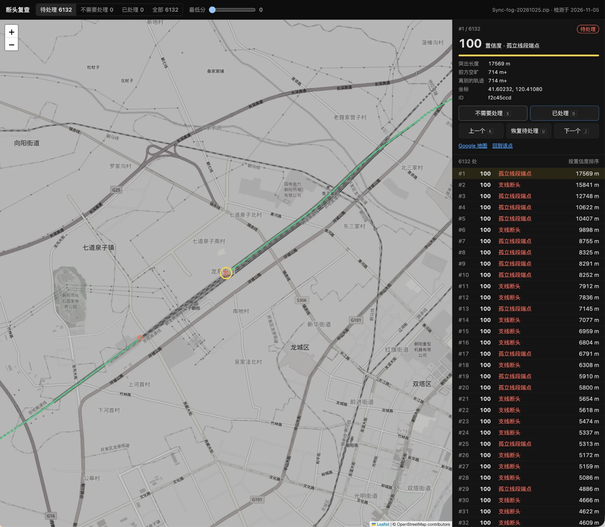

# Fog Trace

[](LICENSE) [](https://github.com/sponsors/b-z)

[中文](docs/zh/README.md) · [日本語](docs/ja/README.md)

**Find and fix the places where your Fog of World tracks break off, right in the browser.**

### 👉 [Open Fog Trace](https://fog-trace.pages.dev/)

Fog Trace opens the data of [Fog of World](https://fogofworld.app) and finds the **dead ends** in your tracks: trips that start or stop in the middle of nowhere, places where you turned back, and gaps where GPS dropped out. You review them one by one, sorted by how likely they are to be real, and you can fix what you find: erase GPS glitches, draw in the road you actually took, and export an archive the app can import.

It is a static web page. Your archive is read and processed only in your browser and is never uploaded; marks and edits are stored in your browser too.

<p align="center"></p>

*The review page (Chinese interface). The list on the right is sorted by confidence; the selected dead end (yellow ring) is where a track recorded on a high-speed train breaks off.*

> Fog Trace is an independent project and is not affiliated with Fog of World or its developer. Back up your archive before importing an edited one into the app.

## How to use

1. Open [fog-trace.pages.dev](https://fog-trace.pages.dev/) and choose the app's `Sync` folder, a zip of it, or an app snapshot (`.fwss`). You can also drop it on the page.
2. Dead ends are detected automatically: a few seconds for a whole archive. Red points on the map are the ones to review.
3. Review from the highest confidence down: `J` / `K` next / previous, `X` ignore, `D` fixed, `U` undo. Reviewed points turn gray.
4. Fix what needs fixing with the tools above the map: the eraser for GPS glitches, the pen for missing roads. Then click "Re-detect"; only the areas you changed are computed again (well under a second).
5. Click "Export archive" to download `Sync-edited-….zip` (or, for a snapshot, a new `Snapshot-….fwss`) and import it back into the app.

**Where the archive is.** With sync turned on, the app keeps your data in a `Sync` folder (one file per map area). With iCloud on a Mac it is `~/Library/Mobile Documents/iCloud~com~ollix~FogOfWorld/Documents/Sync`: in the file dialog press `⌘⇧G` and paste the path. Files that are still only in iCloud must be downloaded in Finder first. With Dropbox it is the `Sync` folder inside the app's Dropbox folder.

**Snapshots.** If you use the app's snapshots instead of sync, open a `.fwss` file: they are in `Databases/<name>.fwdb/Snapshots/<year>/<month>/` in the same app folder. A snapshot holds the tracks plus two layers derived from them (per-subtile counts and a zoom pyramid); when you export an edited snapshot, both are recomputed for every block you changed, so the snapshot stays consistent.

The page is available in English, Chinese and Japanese (switch at the top right).

## Features

| Feature | What it does |
|---|---|
| Dead-end detection | Finds where tracks stick out without connecting to anything: the start and end of trips, turning back, lost GPS signal. Each place gets a confidence from 0 to 100 |
| Review | Sorted by confidence. The tabs filter the list; the map always shows every point (red = to review, gray = reviewed). A "Min score" slider hides weak candidates |
| Box `B` | Drag a box to mark every red point inside as "ignored" at once; handy for clearing a whole area of false detections |
| Eraser `E` | Drag to erase. `[` `]` change the size; hold Space to pan; zoom in to level 12 or more |
| Pen `P` | A 1-pixel line, as thin as the tracks. Click to add points; right-click, double-click or `Enter` to finish; `Backspace` removes the last point, `Esc` cancels |
| Snapping | Pen points snap to nearby dead ends and line ends (solid ring), otherwise to the nearest track pixel (dashed ring). Hold `⌥` to turn snapping off |
| Undo `⌘Z` / Redo `⇧⌘Z` | One erase stroke or one line is one step |
| Export archive | Only the blocks you changed are re-encoded; every other file is copied byte for byte. A block erased to nothing is left out, as the app itself does |

## How detection works

The archive is processed in windows of 32 × 32 subtiles (2048 × 2048 pixels) with a margin of 4 subtiles, in parallel Web Workers:

bitmap → dilate by 1 px (bridges raster gaps) → skeletonize → prune spurs shorter than 6 px → skeleton endpoints → score

The **confidence** (0–100) is the product of three saturating factors, so any one of them being small keeps the score low:

- **Sticks out**: length from the endpoint back to the nearest junction along the skeleton (very short ≈ GPS jitter).
- **Clear ahead**: distance to the next track inside a ±35° cone in the direction the end points (≤ 3 px means the track actually continues and only the skeleton broke).
- **To other track**: distance from the end to any track that is not its own branch (≈ 1 px means a false end inside a thick band of tracks).

**Kinds**: branch end (sticks out from a track and stops), loose segment end (neither end connects, usually lost signal), lone dot.

Window results are cached in the browser by content hash, so detecting again after edits, or on a newer sync of the same data, only recomputes the windows that changed.

## Your marks follow you

All archives share one set of marks. When you open another archive (a newer sync, an older backup, an exported one) it is detected automatically and the marks are carried over:

- A new detection within 6 px of an old point that points the same way (within 60°) is the same dead end: it keeps its ID and mark, with the new position and score. Two ends facing each other across a gap are not merged.
- Marked points are never deleted. Those not detected in the current archive (fixed, or from another archive) are kept and shown faded.
- Points still to review that are no longer detected are dropped (usually because they were fixed).

The "Archive & marks" menu can **export marks** as JSON (backup, or moving to another device) and **import** them again. Clearing the site's data in the browser deletes the marks too, so keep a backup.

## Related project

[**fogprint**](https://github.com/b-z/fogprint): ask an AI agent such as Claude Code or Codex about your Fog of World map. Which countries, prefectures or rail lines you have not been to yet, what a trip added, and a plan to fill the gaps. Fog Trace cleans up the map; fogprint answers questions about it.

## Command-line tools (`tools/`)

| Tool | Purpose |
|---|---|
| `deadends.py` | Python reference implementation of the detector (numpy + scipy + scikit-image). Its JSON output can be imported in the page with "Import marks" |
| `detect_node.js` | Runs the page's detector in Node (the same `web/src/detect-core.js`) |
| `compare_raw.py` | Compares the two detectors' results field by field |
| `check_export.py` | Checks an exported archive (zip, folder or snapshot): format of every block, unchanged blocks byte-identical, the derived layers of a snapshot, and with `--ops` an independent pixel-by-pixel replay of the edit log |
| `apply_edits.js` | Applies an edit log to an archive without a browser (same code as the page) |
| `store_selftest.js` | Self-test of the storage layer: file names, no-op re-encoding, real edits |

The browser detector gives exactly the same result as the Python one: the skeletonization lookup table and the exact Euclidean feature transform (including which pixel wins a tie) are ported from scikit-image and SciPy.

```bash
pip install -r tools/requirements.txt
python3 tools/deadends.py Sync.zip --state /tmp/state.json --raw /tmp/py.json   # about 3 minutes
node tools/detect_node.js Sync.zip --raw /tmp/js.json                           # about 6 seconds
python3 tools/compare_raw.py /tmp/py.json /tmp/js.json
```

## Run locally and deploy

The page must be served over HTTP (Web Workers do not load from `file://`):

```bash
python3 -m http.server 8000 --directory web
```

Then open <http://localhost:8000/>. It needs a current Chrome, Edge, Safari or Firefox (`DecompressionStream`, Web Workers, IndexedDB).

Every push to `main` that changes `web/` deploys the site to Cloudflare Pages (`.github/workflows/deploy.yml`, using the repository secrets `CLOUDFLARE_API_TOKEN` and `CLOUDFLARE_ACCOUNT_ID`). To deploy by hand:

```bash
npx wrangler@4 pages deploy web --project-name fog-trace --branch main
```

## Code structure

| File | Contents |
|---|---|
| `web/index.html` | The page: opening archives, review list, card, detection progress, marks import / export |
| `web/src/i18n.js` | Interface text in English, Chinese and Japanese |
| `web/src/decoder.js` | Decodes a zip into blocks |
| `web/src/geo.js` | Latitude / longitude ↔ world pixels |
| `web/src/fog-layer.js` | Leaflet layer that draws the tracks |
| `web/src/fog-store.js` | Editable archive: erase / draw, diffs for undo, block encoding and export |
| `web/src/editor.js` | Map editing: toolbar, eraser, pen with snapping, box selection |
| `web/src/detect-core.js` | Dead-end detection for one window |
| `web/src/detect.js` | Windows, worker pool, cache, dedupe, merging marks |
| `web/src/detect-worker.js` | Web Worker |
| `web/src/storage.js` | IndexedDB: marks, edit logs, the last archive, detection cache |
| `web/vendor/` | Leaflet 1.9.4 and JSZip 3.10.1, served locally (no CDN) |

## Basemap

The basemap uses the OpenStreetMap tile servers, which per the [tile usage policy](https://operations.osmfoundation.org/policies/tiles/) suit personal, low-traffic use. For heavy traffic, switch to another tile provider (`BASEMAP` in `web/index.html`). Decoding, detection and drawing of your tracks do not depend on any external service.

## Credits

- Archive format: the "迷雾资料库" articles on reverse-engineering Fog of World, and vicc.wang's "迷雾橡皮擦" (fog eraser).
- The skeletonization and distance transform in the detector are ported from [scikit-image](https://scikit-image.org/) and [SciPy](https://scipy.org/) (BSD-3-Clause); see [THIRD_PARTY_NOTICES.md](THIRD_PARTY_NOTICES.md).
- Map: [Leaflet](https://leafletjs.com/), © [OpenStreetMap](https://www.openstreetmap.org/copyright) contributors.

## Support the project

Fog Trace is maintained in spare time. If it helped clean up your map, you can support it through [GitHub Sponsors](https://github.com/sponsors/b-z) or with WeChat. Sponsoring is entirely optional and does not affect how issues or pull requests are handled.

<table><tr>
<td align="center" valign="middle"><a href="https://github.com/sponsors/b-z"></a></td>
<td align="center" valign="middle"></td>
</tr></table>

## License

[MIT](LICENSE).
