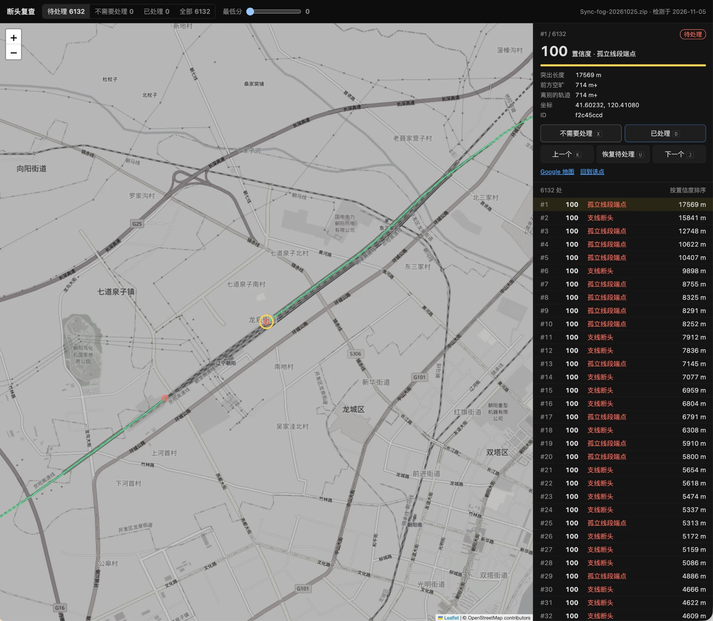

# Fog Trace

[](../../LICENSE) [](https://github.com/sponsors/b-z)

[English](../../README.md) · [中文](../zh/README.md)

**Fog of World の軌跡が途切れている場所を、ブラウザで見つけて直す。**

### 👉 [Fog Trace を開く](https://fog-trace.pages.dev/)

Fog Trace は [Fog of World](https://fogofworld.app)のデータを読み込み、軌跡の**途切れ**を見つけます。何もない場所で始まる・終わる移動、引き返した場所、GPS が途切れてできた隙間などです。本当に途切れている可能性が高い順に 1 か所ずつ確認し、見つけた問題はその場で直せます。GPS の飛びを消し、実際に通った道を描き足して、アプリに読み込めるアーカイブとして書き出します。

静的なウェブページです。アーカイブはブラウザの中だけで読み込み・処理され、アップロードされません。マークと編集履歴もブラウザに保存されます。

<p align="center"></p>

*確認画面（中国語表示）。右のリストは信頼度順で、選択中の途切れ（黄色の円）は新幹線で記録した軌跡が途切れている場所です。*

> Fog Trace は個人の独立したプロジェクトで、Fog of World とその開発者とは関係ありません。編集したアーカイブをアプリに読み込む前に、元のアーカイブをバックアップしてください。

## 使い方

1. [fog-trace.pages.dev](https://fog-trace.pages.dev/) を開き、アプリの `Sync` フォルダ、それを zip にしたもの、またはアプリのスナップショット（`.fwss`）を選びます。ページにドロップしても開けます。
2. 途切れは自動で検出されます。アーカイブ全体で数秒です。地図上の赤い点が未対応の途切れです。
3. 信頼度の高い順に確認します：`J` / `K` で次 / 前、`X` で対応不要、`D` で対応済み、`U` で元に戻す。マークした点は灰色になります。
4. 直すところは地図上部のツールで編集します。消しゴムで GPS の飛びを消し、ペンで足りない道を描き足します。編集後に「再検出」を押すと、変えた範囲だけを計算し直します（1 秒もかかりません）。
5. 「アーカイブを書き出す」で `Sync-edited-….zip`（スナップショットを開いた場合は新しい `Snapshot-….fwss`）をダウンロードし、アプリに読み込みます。

**アーカイブの場所。** 同期をオンにすると、データは同期先の `Sync` フォルダに保存されます（1 ファイルが 1 区画）。iCloud 同期の Mac では `~/Library/Mobile Documents/iCloud~com~ollix~FogOfWorld/Documents/Sync` です。ファイル選択画面で `⌘⇧G` を押してパスを貼り付けてください。iCloud にしかないファイルは先に Finder でダウンロードします。Dropbox 同期では、Dropbox 内のアプリ用フォルダにある `Sync` です。

**スナップショット。** 同期を使わずアプリのスナップショットだけを使っている場合は、`.fwss` ファイルを開いてください。同じアプリフォルダの `Databases/<名前>.fwdb/Snapshots/<年>/<月>/` にあります。スナップショットには軌跡のほかに、軌跡から計算される 2 つの層（サブタイルごとのピクセル数と縮小ピラミッド）が入っています。編集したスナップショットを書き出すと、変更したブロックに関わる部分を両方とも計算し直すので、スナップショットの整合性は保たれます。

ページは日本語・English・中文に対応しています（右上で切り替え）。

## 機能

| 機能 | 内容 |
|---|---|
| 途切れの検出 | 軌跡がどこにもつながらずに突き出ている場所を見つけます：移動の始点・終点、引き返し、GPS の途切れ。各地点に 0〜100 の信頼度が付きます |
| 確認 | 信頼度順。上のタブはリストだけを絞り込み、地図には常にすべての点を表示します（赤＝未対応、灰色＝マーク済み）。「最低スコア」で弱い候補を隠せます |
| 範囲選択 `B` | 四角で囲み、中の未対応の赤い点をまとめて「対応不要」にします。誤検出がまとまっている範囲を一気に片付けるのに使えます |
| 消しゴム `E` | ドラッグで消します。`[` `]` でサイズ変更、Space を押している間は地図を移動、ズーム 12 以上で使えます |
| ペン `P` | 軌跡と同じ 1 ピクセルの線。クリックで点を追加、右クリック・ダブルクリック・`Enter` で確定、`Backspace` で最後の点を削除、`Esc` で取り消し |
| 吸着 | ペンの点は近くの途切れや線の端に吸着し（実線の円）、なければ最寄りの軌跡ピクセルに吸着します（点線の円）。`⌥` を押している間は吸着しません |
| 元に戻す `⌘Z` / やり直す `⇧⌘Z` | 消しゴムの 1 ストローク、ペンの 1 本が 1 ステップです |
| アーカイブの書き出し | 変更したブロックだけを作り直し、ほかのファイルはバイト単位でそのままコピーします。すべて消したブロックはファイルを書きません（アプリと同じ動作） |

## 検出のしくみ

アーカイブを 32 × 32 サブタイル（2048 × 2048 ピクセル）の区画に分け、周囲 4 サブタイルの余白を付けて、Web Worker で並列に処理します。

ビットマップ → 1 ピクセル膨張（ラスターの隙間を埋める）→ 細線化 → 6 ピクセル未満のひげを除去 → 骨格の端点 → スコア

**信頼度**（0〜100）は 3 つの飽和する要素の積で、どれか 1 つでも小さければスコアは低くなります。

- **突き出た長さ**：端点から骨格に沿って最寄りの分岐点までの長さ（とても短い ≈ GPS のぶれ）。
- **前方の空き**：端点の向きの ±35° の範囲で、次の軌跡までの距離（3 ピクセル以下なら軌跡は実際には続いていて、骨格だけが切れている）。
- **他の軌跡まで**：自分の枝ではない軌跡までの最短距離（≈ 1 ピクセルなら太い軌跡の帯の中の偽の端点）。

**種類**：枝の行き止まり（軌跡から突き出て止まる）、孤立した線の端（両端ともつながらない、多くは電波の途切れ）、孤立点。

区画ごとの結果は内容のハッシュでブラウザにキャッシュされるので、編集後や同じデータの新しい同期を開いたときは、変わった区画だけを計算し直します。

## マークは引き継がれる

マークはすべてのアーカイブで共通です。別のアーカイブ（新しい同期、古いバックアップ、書き出したもの）を開くと自動で検出し、マークを次のルールで引き継ぎます。

- 新しく検出した端点が古い点から 6 ピクセル以内で、向きの差が 60° 以内なら同じ途切れとみなし、ID とマークを引き継いで位置とスコアを更新します。隙間をはさんで向かい合う 2 つの端は合わせません。
- マークした点は削除しません。現在のアーカイブで検出されなかったもの（修正済み、または別のアーカイブのもの）は残し、薄く表示します。
- もう検出されない未対応の点は外します（たいていは修正済み）。

「アーカイブとマーク」メニューから、マークを JSON に**書き出し**（バックアップや別の端末への移行）、また**読み込め**ます。ブラウザでサイトのデータを消去するとマークも消えるので、バックアップを取っておいてください。

## 関連プロジェクト

[**fogprint**](https://github.com/b-z/fogprint)：Claude Code や Codex などの AI エージェントに、Fog of World の地図について質問できるツールです。まだ行っていない国・都道府県・鉄道路線、旅行で何が増えたか、そして残りを埋める計画まで。Fog Trace は地図を整え、fogprint は地図についての質問に答えます。

## コマンドラインツール（`tools/`）

| ツール | 用途 |
|---|---|
| `deadends.py` | 検出の Python 参照実装（numpy + scipy + scikit-image）。出力した JSON はページの「マークを読み込む」で使えます |
| `detect_node.js` | ページの検出を Node で実行します（同じ `web/src/detect-core.js`） |
| `compare_raw.py` | 2 つの検出結果をフィールドごとに比較します |
| `check_export.py` | 書き出したアーカイブ（zip、フォルダ、スナップショット）を検証：各ブロックの形式、未変更ブロックのバイト一致、スナップショットの派生層、`--ops` 付きで編集履歴をピクセル単位で独立に再生して比較 |
| `apply_edits.js` | ブラウザなしで編集履歴をアーカイブに適用します（ページと同じコード） |
| `store_selftest.js` | 保存処理のセルフテスト：ファイル名、無変更での再エンコード、実際の編集 |

ブラウザ版の検出結果は Python 版と完全に一致します。細線化のルックアップテーブルと厳密なユークリッド特徴変換（等距離のときにどのピクセルを選ぶかまで）を scikit-image と SciPy から移植しています。

```bash
pip install -r tools/requirements.txt
python3 tools/deadends.py Sync.zip --state /tmp/state.json --raw /tmp/py.json   # 約 3 分
node tools/detect_node.js Sync.zip --raw /tmp/js.json                           # 約 6 秒
python3 tools/compare_raw.py /tmp/py.json /tmp/js.json
```

## ローカルで動かす・デプロイ

ページは HTTP 経由で開く必要があります（Web Worker は `file://` から読み込めません）。

```bash
python3 -m http.server 8000 --directory web
```

<http://localhost:8000/> を開きます。新しめの Chrome、Edge、Safari、Firefox が必要です（`DecompressionStream`、Web Worker、IndexedDB を使用）。

`web/` を変更して `main` に push すると、Cloudflare Pages に自動でデプロイされます（`.github/workflows/deploy.yml`、リポジトリの Secrets `CLOUDFLARE_API_TOKEN` と `CLOUDFLARE_ACCOUNT_ID` を使用）。手動でデプロイする場合：

```bash
npx wrangler@4 pages deploy web --project-name fog-trace --branch main
```

## コード構成

| ファイル | 内容 |
|---|---|
| `web/index.html` | ページ：アーカイブを開く、確認リスト、カード、検出の進行状況、マークの読み込み・書き出し |
| `web/src/i18n.js` | 画面の文言（英語・中国語・日本語） |
| `web/src/decoder.js` | zip をブロックに展開 |
| `web/src/geo.js` | 緯度経度 ↔ ワールドピクセル |
| `web/src/fog-layer.js` | 軌跡を描く Leaflet レイヤー |
| `web/src/fog-store.js` | 編集できるアーカイブ：消す・描く、元に戻すための差分、ブロックのエンコードと書き出し |
| `web/src/editor.js` | 地図の編集：ツールバー、消しゴム、吸着付きのペン、範囲選択 |
| `web/src/detect-core.js` | 1 区画分の途切れ検出 |
| `web/src/detect.js` | 区画分割、Worker プール、キャッシュ、重複除去、マークの統合 |
| `web/src/detect-worker.js` | Web Worker |
| `web/src/storage.js` | IndexedDB：マーク、編集履歴、最後に開いたアーカイブ、検出キャッシュ |
| `web/vendor/` | Leaflet 1.9.4、JSZip 3.10.1（ローカル配信、CDN なし） |

## 背景地図

背景地図は OpenStreetMap のタイルサーバーを使っています。[タイル利用ポリシー](https://operations.osmfoundation.org/policies/tiles/)上、個人・少量の利用向けです。アクセスが多い場合は別のタイル配信に切り替えてください（`web/index.html` の `BASEMAP`）。軌跡の読み込み・検出・描画は外部サービスに依存しません。

## クレジット

- アーカイブ形式：WeChat 公式アカウント「迷雾资料库」の Fog of World 解析記事、および vicc.wang の「迷雾橡皮擦」。
- 検出の細線化と距離変換は [scikit-image](https://scikit-image.org/) と [SciPy](https://scipy.org/)（BSD-3-Clause）から移植しています。[THIRD_PARTY_NOTICES.md](../../THIRD_PARTY_NOTICES.md) を参照してください。
- 地図：[Leaflet](https://leafletjs.com/)、© [OpenStreetMap](https://www.openstreetmap.org/copyright) contributors。

## プロジェクトを支援する

Fog Trace は空き時間に保守しています。地図の整理に役立ったら、[GitHub Sponsors](https://github.com/sponsors/b-z) や WeChat で支援していただけるとうれしいです。支援は任意で、Issue やプルリクエストの扱いには影響しません。

<table><tr>
<td align="center" valign="middle"><a href="https://github.com/sponsors/b-z"></a></td>
<td align="center" valign="middle"></td>
</tr></table>

## ライセンス

[MIT](../../LICENSE)。
