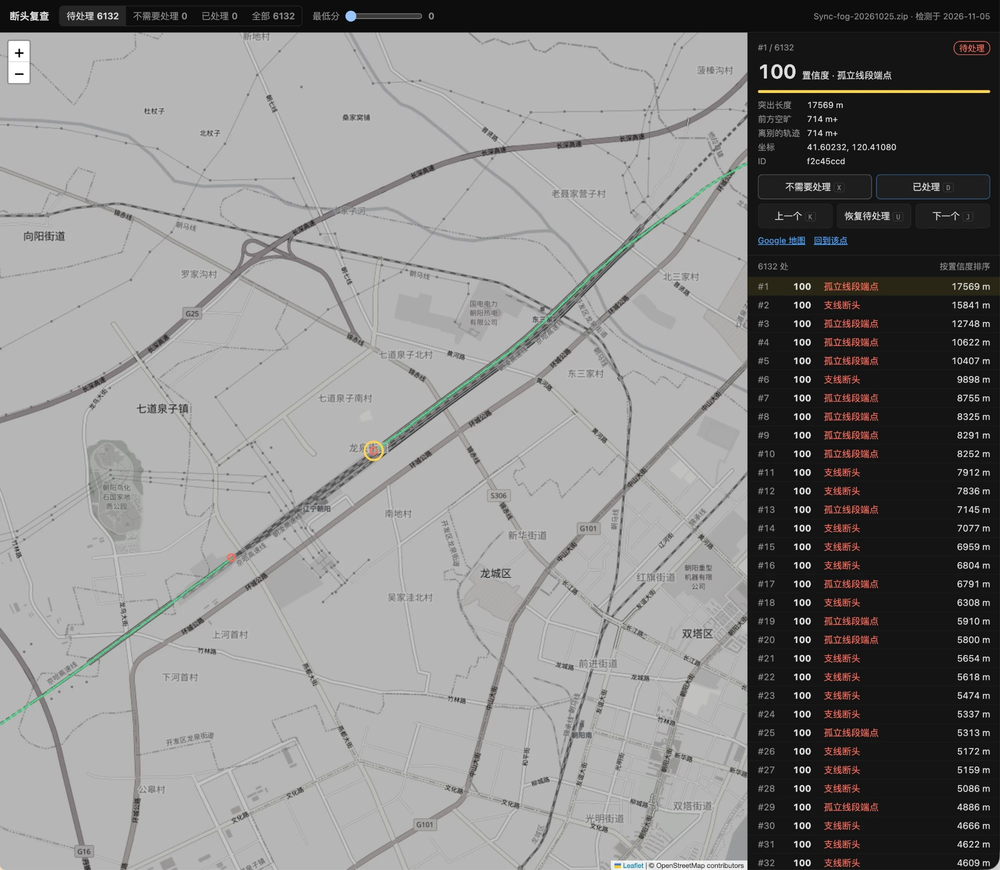

# Fog Trace

[](../../LICENSE) [](https://github.com/sponsors/b-z)

[English](../../README.md) · [日本語](../ja/README.md)

**在浏览器里找出并修好《世界迷雾》轨迹的断点。**

### 👉 [打开 Fog Trace](https://fog-trace.pages.dev/)

Fog Trace 读取 [世界迷雾 (Fog of World)](https://fogofworld.app) 的数据，找出轨迹里的**断点**：在荒郊野外开始或结束的行程、原路折返的地方、GPS 信号丢失留下的缺口。你可以按「是真断点的可能性」从高到低逐个复查，发现问题顺手修：擦掉 GPS 飘出去的线、补上实际走过的路，再导出成 App 能导入的存档。

它是一个纯静态网页。存档只在你的浏览器里读取和处理，不会上传；标记和编辑记录也只存在你的浏览器里。

<p align="center"></p>

*复查页。右侧列表按置信度排序；选中的断点（黄圈）是一段高铁上记录的轨迹断开的地方。*

> Fog Trace 是独立项目，与世界迷雾及其开发者无关。把改过的存档导回 App 之前，请先备份原来的存档。

## 怎么用

1. 打开 [fog-trace.pages.dev](https://fog-trace.pages.dev/)，选择 App 的 `Sync` 文件夹，或者它压缩成的 zip（也可以直接拖进页面）。
2. 自动检测断点，整份存档几秒钟。地图上的红点就是待处理的断点。
3. 按置信度从高到低复查：`J` / `K` 下一个 / 上一个，`X` 不需要处理，`D` 已处理，`U` 撤销。标过的点变成灰色。
4. 需要修的地方用地图上方的工具改：橡皮擦擦掉 GPS 飘线，画笔补上缺的路。改完点「重新检测」，只重算改过的区域（不到一秒）。
5. 点「导出存档」下载 `Sync-edited-….zip`，再导回 App。

**存档在哪里。** App 开启同步后，数据在同步目录的 `Sync` 文件夹里（每个文件是一块地图区域）。iCloud 同步的 Mac 上在 `~/Library/Mobile Documents/iCloud~com~ollix~FogOfWorld/Documents/Sync`：在文件选择窗口里按 `⌘⇧G` 粘贴路径。还只在 iCloud 云端的文件要先在 Finder 里下载。Dropbox 同步的在 Dropbox 里 App 文件夹下的 `Sync`。

网页支持中文、English、日本語，右上角切换。

## 功能

| 功能 | 说明 |
|---|---|
| 断点检测 | 找出轨迹「突出来、不和别处相连」的地方：行程的起点终点、原路折返、GPS 信号丢失。每处有 0–100 的置信度 |
| 复查 | 按置信度排序。上方分类只筛右侧列表，地图上始终显示全部点（红色待处理，灰色已标记）；「最低分」滑块隐藏低分的点 |
| 框选 `B` | 拖出矩形框，将框内的待处理红点批量标为「不需要处理」；它可以用于快速排除一大片误检的点 |
| 橡皮擦 `E` | 按住拖动擦除；`[` `]` 调大小；按住空格临时拖地图；放大到 12 级以上才能擦 |
| 画笔 `P` | 1 像素细线，与轨迹同宽。单击加点；右键、双击或 `Enter` 结束；`Backspace` 删上一个点，`Esc` 取消 |
| 吸附 | 画笔顶点自动接到附近的断点和线的端点（实线圈），其次接到最近的轨迹像素（虚线圈）；按住 `⌥` 不吸附 |
| 撤销 `⌘Z` / 重做 `⇧⌘Z` | 一次拖擦或一条折线为一步 |
| 导出存档 | 只重新编码改过的区块，其余文件逐字节原样保留；整块擦空的区块不写文件（与 App 的做法一致） |

## 检测原理

存档按窗口处理，每个窗口 32 × 32 个子瓦片（2048 × 2048 像素）外加 4 个子瓦片的边距，用 Web Worker 并行：

位图 → 膨胀 1 像素（补栅格缝）→ 骨架化 → 剪掉短于 6 像素的毛刺 → 骨架端点 → 打分

**置信度**（0–100）是三个饱和因子的乘积，任何一项小都会把分数压低：

- **突出长度**：从端点沿骨架回溯到最近分叉点的长度（很短 ≈ GPS 抖动）。
- **前方空旷**：沿端点朝向 ±35° 锥形内到下一段轨迹的距离（≤ 3 像素说明轨迹其实接着走，只是骨架断了）。
- **离别的轨迹**：端点到「不属于自己这条支线」的轨迹的最近距离（≈ 1 像素说明是粗轨迹带里的假端点）。

**类型**：支线断点（从轨迹伸出后停住）、孤立线段端点（两头都不连，多为信号丢失）、孤立点。

窗口结果按内容哈希缓存在浏览器里，编辑后再次检测、或打开同一份数据较新的同步，只重算内容变了的窗口。

## 标记会跟着走

所有存档共用一份标记。打开别的存档（较新的同步、较早的备份、导出的存档）时会自动检测，标记按以下规则沿用：

- 新检测与旧点相距 ≤ 6 像素、且朝向相差 ≤ 60°，算同一个断点：沿用 ID 和标记，位置和分数更新。断口两侧相对的两个端头不会被合并。
- 标过的点永不删除。当前存档里没检测到的（已修好，或来自别的存档）保留并变淡显示。
- 没再检测到的待处理点去掉（多半是修好了）。

「存档与标记」菜单可以把标记**导出**成 JSON（备份或换设备），也可以再**导入**。浏览器清除网站数据会把标记一起删掉，记得备份。

## 相关项目

[**fogprint**](https://github.com/b-z/fogprint)：让 Claude Code、Codex 等 AI 读懂你的世界迷雾地图。哪些国家、都道府县、铁路线还没去过，一次旅行点亮了什么，以及怎么去补。Fog Trace 负责把地图整理干净，fogprint 负责回答关于地图的问题。

## 命令行工具（`tools/`）

| 工具 | 用途 |
|---|---|
| `deadends.py` | 检测的 Python 参考实现（numpy + scipy + scikit-image），输出的 JSON 可以在网页里「导入标记」 |
| `detect_node.js` | 在 Node 里跑网页版的检测（同一份 `web/src/detect-core.js`） |
| `compare_raw.py` | 逐字段比对两边的检测结果 |
| `check_export.py` | 校验导出的存档：每个区块的格式、未改区块逐字节一致；带 `--ops` 时独立重放编辑记录逐像素比对 |
| `apply_edits.js` | 不开浏览器，把编辑记录套到存档上导出（与网页同一套代码） |
| `store_selftest.js` | 存储层自测：文件名、无改动重新编码、真实编辑 |

浏览器版的检测结果与 Python 版完全一致：骨架化的查表和精确欧氏特征变换（包括等距时取哪个像素）都移植自 scikit-image 和 SciPy。

```bash
pip install -r tools/requirements.txt
python3 tools/deadends.py Sync.zip --state /tmp/state.json --raw /tmp/py.json   # 约 3 分钟
node tools/detect_node.js Sync.zip --raw /tmp/js.json                           # 约 6 秒
python3 tools/compare_raw.py /tmp/py.json /tmp/js.json
```

## 本地运行与部署

网页需要经 HTTP 打开（Web Worker 不能从 `file://` 加载）：

```bash
python3 -m http.server 8000 --directory web
```

然后打开 <http://localhost:8000/>。需要较新的 Chrome、Edge、Safari 或 Firefox（用到 `DecompressionStream`、Web Worker、IndexedDB）。

push 到 `main` 且改动了 `web/` 时，会自动部署到 Cloudflare Pages（`.github/workflows/deploy.yml`，用仓库 Secrets 里的 `CLOUDFLARE_API_TOKEN` 和 `CLOUDFLARE_ACCOUNT_ID`）。手动部署：

```bash
npx wrangler@4 pages deploy web --project-name fog-trace --branch main
```

## 代码结构

| 文件 | 内容 |
|---|---|
| `web/index.html` | 页面：打开存档、复查列表、卡片、检测进度、标记导入导出 |
| `web/src/i18n.js` | 界面文字（英文、中文、日文） |
| `web/src/decoder.js` | 解码 zip → 区块 |
| `web/src/geo.js` | 经纬度 ↔ 世界像素 |
| `web/src/fog-layer.js` | Leaflet 轨迹图层 |
| `web/src/fog-store.js` | 可编辑存档：擦 / 画、撤销用的差异、区块编码与导出 |
| `web/src/editor.js` | 地图编辑：工具栏、橡皮擦、带吸附的画笔、框选 |
| `web/src/detect-core.js` | 一个窗口的断点检测 |
| `web/src/detect.js` | 分窗口、Worker 池、缓存、去重、合并标记 |
| `web/src/detect-worker.js` | Web Worker |
| `web/src/storage.js` | IndexedDB：标记、编辑记录、最近的存档、检测缓存 |
| `web/vendor/` | Leaflet 1.9.4、JSZip 3.10.1（本地文件，不走 CDN） |

## 底图

底图用 OpenStreetMap 官方瓦片，按[瓦片使用政策](https://operations.osmfoundation.org/policies/tiles/)适合个人和小流量使用。访问量大时请换成别的瓦片服务（改 `web/index.html` 里的 `BASEMAP`）。轨迹的解码、检测和绘制不依赖任何外部服务。

## 致谢

- 存档格式：微信公众号「迷雾资料库」的世界迷雾逆向工程系列文章，以及 vicc.wang 的「迷雾橡皮擦」。
- 检测中的骨架化与距离变换移植自 [scikit-image](https://scikit-image.org/) 和 [SciPy](https://scipy.org/)（BSD-3-Clause），见 [THIRD_PARTY_NOTICES.md](../../THIRD_PARTY_NOTICES.md)。
- 地图：[Leaflet](https://leafletjs.com/)、© [OpenStreetMap](https://www.openstreetmap.org/copyright) contributors。

## 支持这个项目

Fog Trace 是在业余时间维护的。如果它帮你把地图整理得更干净，欢迎通过 [GitHub Sponsors](https://github.com/sponsors/b-z) 或微信赞赏支持。赞助完全自愿，不会影响 Issue 和 Pull Request 的处理。

<table><tr>
<td align="center" valign="middle"><a href="https://github.com/sponsors/b-z"></a></td>
<td align="center" valign="middle"></td>
</tr></table>

## 许可证

[MIT](../../LICENSE)。
